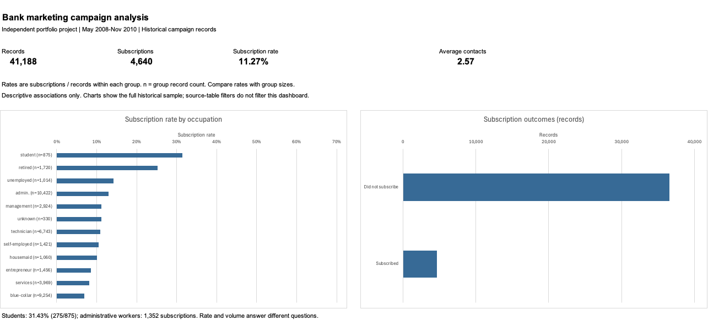
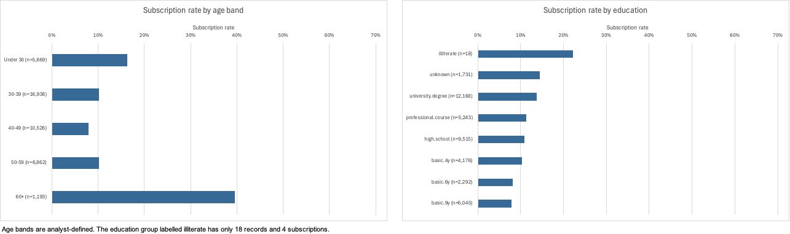
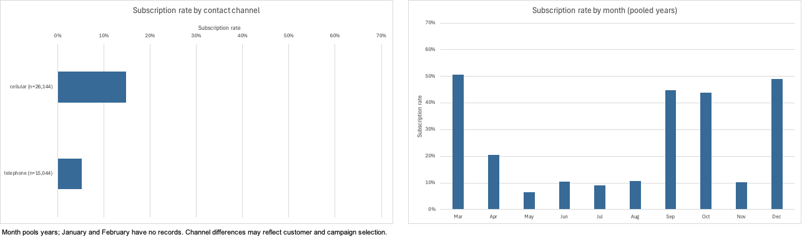
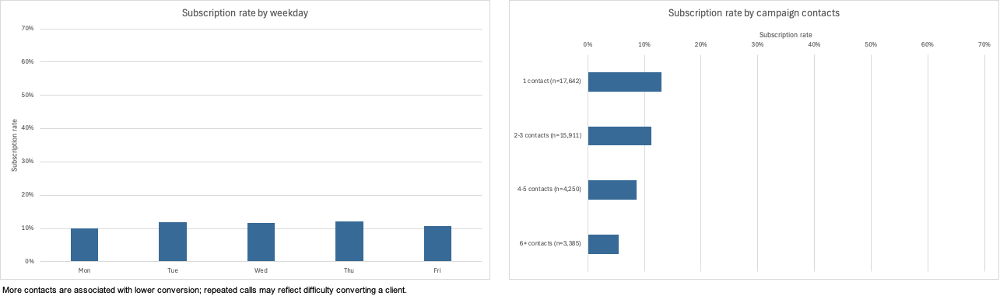
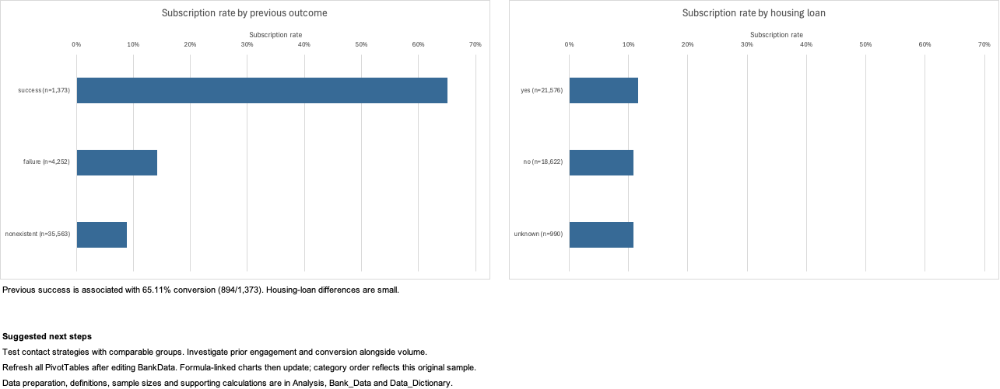

# Bank Marketing Campaign Analysis in Excel

I'm **Abdul Rahman El Issa**, a Business Intelligence student. In this project, I used Excel to analyze public data from a Portuguese banking campaign.

I worked with 41,188 campaign records to compare subscription rates across customer groups, contact methods and previous campaign outcomes.

I built the dashboard in Excel and used Python to check the results.



## Business question

Which groups and contact patterns have higher observed subscription rates, and which follow-up questions should the marketing team test?

The analysis considers both **subscription rate** and **subscription volume**. A high conversion rate in a small group does not necessarily produce the most subscriptions.

## Baseline results

| Measure | Result |
|---|---:|
| Campaign records | 41,188 |
| Term-deposit subscriptions | 4,640 |
| Non-subscriptions | 36,548 |
| Overall subscription rate | 11.27% |
| Average campaign contacts per record | 2.57 |

The denominator is the number of records in the selected group. The file does not contain a customer ID, so these figures are not a verified count of unique customers.

## Findings

| Comparison | Observed result | Interpretation |
|---|---|---|
| Occupation | Students: 31.43% (275/875); administrative workers: 12.97% (1,352/10,422) | Students have a higher rate, but administrative workers contribute more subscriptions. |
| Age | Ages 60+: 39.56% (472/1,193) | A strong association in this sample, which requires validation in newer data and comparable groups. |
| Contact channel | Cellular: 14.74% (3,853/26,144); telephone: 5.23% (787/15,044) | Channel choice may be associated with different clients, periods and campaigns. It is not a measured causal uplift. |
| Campaign contacts | One contact: 13.04% (2,300/17,642); six or more: 5.49% (186/3,385) | Further calls may be made to people who are harder to convert. These aggregates do not measure the marginal return from another call. |
| Previous outcome | Previous success: 65.11% (894/1,373); nonexistent: 8.83% (3,141/35,563) | Previous engagement is worth investigating in a controlled follow-up study. |
| Housing loan | Yes: 11.62%; no: 10.88% | The observed difference is small: approximately 0.74 percentage points. |

Recommended next steps are to investigate prior engagement, compare channel strategies using similar client groups, and test contact policies prospectively. No revenue, cost, profit or causal uplift claim is made because the required evidence is absent.

## Ten visualizations

1. Subscription rate by occupation.
2. Overall subscription outcomes, showing record counts.
3. Subscription rate by age band.
4. Subscription rate by education.
5. Subscription rate by contact channel.
6. Subscription rate by month, pooling available years.
7. Subscription rate by weekday.
8. Subscription rate by campaign contact-frequency band.
9. Subscription rate by previous campaign outcome.
10. Subscription rate by housing-loan status.

All rate charts start at zero and use the same 0–70% scale. Most categorical charts display group sizes in their labels. Exact counts for every comparison are available in the PivotTables and [group metrics](results/group_metrics.csv).

Additional dashboard sections:






## Data preparation and limitations

- The original 21 source columns and all 41,188 records are retained. Four formula columns are added separately: subscription indicator, age band, contact-frequency band and prior-contact indicator.
- There are **12 excess exact repeated rows**. They are retained because the absence of a customer identifier prevents a reliable determination that they are erroneous duplicates.
- Literal `unknown` values are retained as distinct categories. There are no empty fields, but `unknown` still represents unavailable information.
- `pdays = 999` means the client was not previously contacted. It is not treated as 999 elapsed days.
- Call duration is known after the call. It is not used for pre-call targeting or as evidence of a deployable prediction model.
- The file covers May 2008–November 2010. It is suitable for historical analysis and method demonstration, not current market estimates.
- Month has no year column. The month comparison pools years, is affected by changing campaign composition, and does not establish seasonality. January and February have no records and are not plotted as zero conversion.
- The education category `illiterate` has only 18 records and 4 subscriptions. Its 22.22% rate is too unstable to support a targeting recommendation.
- Associations are unadjusted and descriptive. Sampling, economic conditions and client/campaign selection may explain differences.
- Source-table filters do not filter the dashboard. Changing data requires refreshing the PivotTables. The category lists and ranking order are intentionally configured for this original dataset; new categories require extending the chart helpers.

## Workbook and reproduction

**[Download the Excel workbook](workbook/Bank_Marketing_Analysis.xlsx).** It contains four sheets: **Dashboard**, **Analysis**, **Bank_Data** and **Data_Dictionary**. The saved file includes all 10 native PivotTables and 10 editable charts. See the [workbook notes](workbook/README.md) for usage and refresh instructions.

- [Step-by-step Excel build guide](docs/excel-walkthrough.md)
- [Source, license and provenance](data/DATA_SOURCE.md)
- [Validation summary](results/validation_summary.json)
- [Live Excel verification record](docs/verification.md)

To independently reproduce the numeric summaries, use Python 3. No third-party packages are needed:

```bash
python3 src/validate_data.py
```

This checks the CSV schema, numeric fields, band boundaries and original totals, then regenerates `results/validation_summary.json` and `results/group_metrics.csv`. It does not create or replace the Excel workbook.

## Source and attribution

Moro, S., Rita, P., & Cortez, P. (2014). *Bank Marketing* [Dataset]. UCI Machine Learning Repository. [https://doi.org/10.24432/C5K306](https://doi.org/10.24432/C5K306).

The source data is licensed under [Creative Commons Attribution 4.0 International](https://creativecommons.org/licenses/by/4.0/). The included raw CSV is unchanged. The workbook adds derived fields, summaries and charts.
